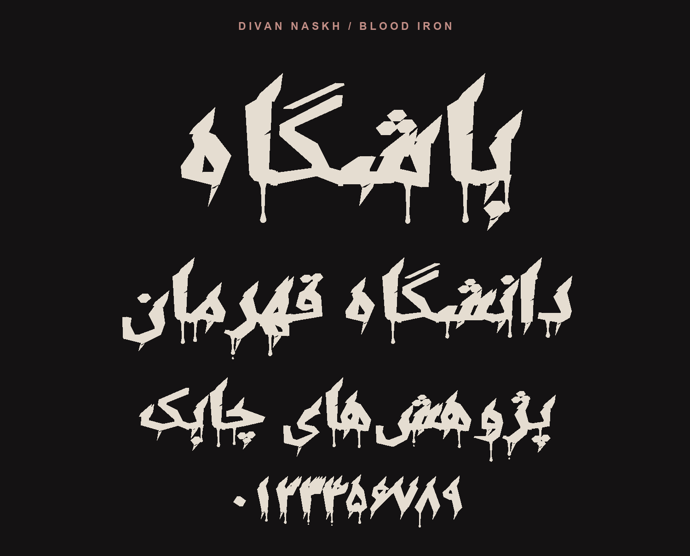

# Divan Naskh Blood Iron

A Persian display typeface adapted by **Iman Fallahzadeh**. It pairs blade-shaped terminals with heavy strokes and long, irregular drips.

## Download and install

Download [DivanNaskh-BloodIron.ttf](DivanNaskh-BloodIron.ttf). On Windows, open the file and select **Install**.

## Credits and license

Blood Iron is an adaptation of [Noto Naskh Arabic](https://github.com/notofonts/arabic) by the Noto Project Authors. The font is distributed under the [SIL Open Font License 1.1](OFL.txt).
